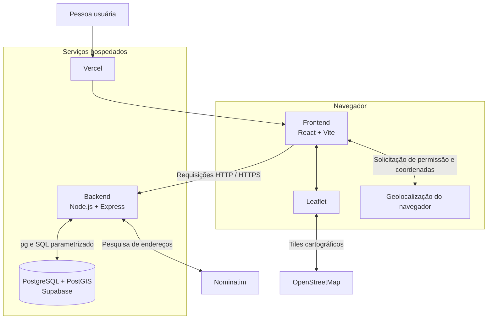

# Arquitetura do EcoMapa

## 1. Objetivo e escopo

O EcoMapa é uma aplicação web para localizar pontos de coleta seletiva no município de Cajazeiras, Paraíba.

A aplicação permite explorar pontos de coleta em um mapa interativo, consultar detalhes e materiais aceitos e realizar operações de cadastro, consulta, edição e exclusão.

O sistema também oferece recursos de localização geográfica, incluindo pesquisa de endereços, geolocalização do navegador e consultas espaciais por proximidade e pelos limites visíveis do mapa.

### Funcionalidades previstas

- Visualizar pontos de coleta em um mapa interativo.
- Consultar detalhes dos pontos e os materiais aceitos.
- Cadastrar, consultar, editar e excluir pontos de coleta.
- Selecionar a localização de um ponto diretamente no mapa.
- Pesquisar endereços e localizar os resultados no mapa.
- Utilizar a geolocalização do navegador mediante permissão da pessoa usuária.
- Buscar pontos de coleta em um raio de 2 km.
- Consultar somente os pontos dentro da área atualmente visível no mapa.
- Identificar visualmente os registros fictícios utilizados para demonstração.

A primeira versão não implementará autenticação de usuários, avaliações, comentários ou gerenciamento de horários de funcionamento.

---

## 2. Tecnologias e serviços

| Camada/serviço | Tecnologia | Responsabilidade |
|---|---|---|
| Frontend | React, Vite e JavaScript | Interface da aplicação |
| Mapa | Leaflet | Exibição e interação com o mapa |
| Dados cartográficos | OpenStreetMap | Informações cartográficas utilizadas pelo mapa |
| Backend | Node.js e Express | API e regras de negócio |
| Banco de dados | PostgreSQL com PostGIS | Persistência e operações espaciais |
| Hospedagem do banco | Supabase | PostgreSQL hospedado |
| Acesso ao banco | Pacote `pg` | Comunicação com PostgreSQL utilizando SQL diretamente, sem ORM |
| Geocodificação | Nominatim | Pesquisa de endereços e geocodificação reversa |
| Desenvolvimento local | Docker | Execução local do PostgreSQL com PostGIS |
| Hospedagem do frontend | Vercel | Publicação da aplicação React |
| Hospedagem do backend | Render | Publicação da API |
| Versionamento | Git e GitHub | Controle de versões e histórico do projeto |

### Decisões técnicas

O frontend será desenvolvido separadamente do backend.

O backend utilizará Node.js com Express para disponibilizar uma API HTTP. As operações de persistência serão realizadas com o pacote `pg`, utilizando consultas SQL parametrizadas diretamente, sem a utilização de ORM.

O PostgreSQL utilizará a extensão PostGIS para armazenar e consultar informações geográficas.

As localizações dos pontos serão armazenadas utilizando o tipo `GEOGRAPHY(Point, 4326)`, permitindo cálculos de distância em metros e consultas espaciais.

---

## 3. Visão da arquitetura e comunicação

A aplicação será organizada em três componentes principais: frontend, backend e banco de dados.



O frontend conversa com o backend para consultar e modificar os pontos de coleta.

O backend é responsável por validar as requisições, executar as regras de negócio e acessar o banco de dados utilizando `pg` e SQL parametrizado.

O Leaflet é utilizado no frontend para apresentar o mapa e permitir a interação com as localizações.

Os dados cartográficos serão obtidos por um serviço baseado em OpenStreetMap.

A busca de endereços será realizada pelo backend, que se comunicará com o Nominatim.

A geolocalização será fornecida pelo navegador somente mediante permissão da pessoa usuária. Caso a permissão seja negada ou a localização não esteja disponível, o mapa utilizará Cajazeiras como localização inicial de referência.

---

## 4. Responsabilidades dos componentes

### 4.1. Frontend

O frontend será responsável por:

- Implementar a interface web utilizando React e Vite.
- Apresentar o mapa interativo utilizando Leaflet.
- Exibir os pontos de coleta e seus respectivos marcadores.
- Consultar e apresentar somente os pontos contidos nos limites visíveis do mapa.
- Apresentar os detalhes dos pontos e os materiais aceitos.
- Disponibilizar formulários para cadastro, edição e exclusão de pontos.
- Permitir selecionar a localização de um ponto diretamente no mapa.
- Permitir pesquisar endereços e visualizar os resultados no mapa.
- Solicitar permissão do navegador antes de utilizar a geolocalização.
- Permitir a busca de pontos em um raio de 2 km da localização obtida.
- Identificar visualmente os registros fictícios por meio da informação `is_demo`.
- Consumir a API do backend, sem estabelecer conexão direta com o banco de dados.

O frontend será responsável pela apresentação e interação com a aplicação, enquanto as regras de negócio e a persistência permanecerão no backend.

### 4.2. Backend

O backend será responsável por:

- Expor a API HTTP utilizando Node.js e Express.
- Receber e validar as requisições do frontend.
- Implementar as operações CRUD dos pontos de coleta.
- Consultar os materiais disponíveis.
- Validar os materiais associados aos pontos.
- Garantir que cada ponto possua pelo menos um material associado.
- Executar operações relacionadas ao cadastro e à edição utilizando transações.
- Validar as coordenadas geográficas recebidas.
- Executar consultas espaciais utilizando PostGIS.
- Consultar pontos próximos em um raio de 2 km.
- Consultar pontos dentro dos limites geográficos enviados pelo frontend.
- Integrar a aplicação ao Nominatim para pesquisa de endereços e geocodificação reversa.
- Centralizar o acesso ao PostgreSQL utilizando o pacote `pg`.
- Utilizar SQL parametrizado para evitar a construção insegura de consultas com valores recebidos diretamente das requisições.

A organização interna utilizará uma arquitetura em camadas, separando rotas, controllers, services, repositories, validações e configurações.

O acesso ao banco será realizado por meio dos repositories, que concentrarão as consultas SQL.

### 4.3. Banco de dados

O banco de dados utilizará PostgreSQL com a extensão PostGIS.

A primeira versão terá três tabelas próprias da aplicação:

- `eco_point`
- `material`
- `eco_point_material`

As localizações serão armazenadas utilizando `GEOGRAPHY(Point, 4326)`.

Um índice espacial GiST será utilizado para apoiar as consultas geográficas.

O banco também utilizará um índice em `material_id` na tabela associativa para apoiar consultas por material.

A modelagem completa está documentada em [data-model.md](data-model.md).

---

## 5. Fluxos principais da aplicação

### 5.1. Exploração do mapa

1. A pessoa usuária acessa a aplicação.
2. O frontend inicializa o mapa utilizando a localização atual, caso permitida, ou Cajazeiras como referência.
3. O Leaflet fornece os limites geográficos da área atualmente visível.
4. O frontend envia esses limites ao backend.
5. O backend executa uma consulta espacial no PostGIS.
6. O banco retorna somente os pontos que pertencem à área consultada.
7. O frontend apresenta os resultados como marcadores no mapa.

A consulta será realizada novamente quando a área visível do mapa mudar, evitando carregar todos os pontos cadastrados a cada acesso.

### 5.2. Busca por proximidade

1. A pessoa usuária permite o acesso à geolocalização do navegador.
2. O frontend obtém latitude e longitude.
3. O frontend envia as coordenadas ao endpoint de proximidade.
4. O backend executa uma consulta utilizando `ST_DWithin`.
5. O PostGIS identifica os pontos localizados em até 2.000 metros.
6. O backend devolve os resultados ao frontend.
7. O frontend apresenta os pontos encontrados.

Caso a geolocalização não esteja disponível ou seja negada, a pessoa poderá utilizar a pesquisa de endereço ou navegar pelo mapa manualmente.

### 5.3. Consulta de detalhes

1. A pessoa usuária seleciona um marcador ou ponto da listagem.
2. O frontend solicita os dados do ponto pelo identificador.
3. O backend consulta o ponto e seus materiais associados.
4. O frontend apresenta as informações retornadas.

### 5.4. Cadastro e edição

1. A pessoa preenche o formulário do ponto.
2. A localização é selecionada diretamente no mapa.
3. O sistema pode utilizar geocodificação reversa para sugerir um endereço.
4. A pessoa confere e pode editar o endereço.
5. Os materiais aceitos são selecionados.
6. O frontend envia os dados ao backend.
7. O backend valida as informações e inicia uma transação.
8. O ponto e seus relacionamentos com os materiais são persistidos.
9. A transação é confirmada quando todas as operações são concluídas.

Caso alguma operação falhe, a transação será revertida para evitar registros parcialmente persistidos.

Na edição, os dados do ponto e seus materiais associados também serão atualizados dentro de uma operação transacional.

### 5.5. Exclusão

1. A pessoa solicita a exclusão de um ponto.
2. O frontend envia a requisição ao backend.
3. O backend realiza a exclusão no banco.
4. A restrição `ON DELETE CASCADE` remove automaticamente os relacionamentos do ponto na tabela `eco_point_material`.

### 5.6. Pesquisa de endereço

1. A pessoa informa um endereço na interface.
2. O frontend envia o texto ao backend.
3. O backend consulta o Nominatim.
4. O resultado é devolvido ao frontend.
5. A pessoa pode selecionar um resultado e visualizar sua localização no mapa.

### 5.7. Geocodificação reversa

1. A pessoa seleciona uma localização diretamente no mapa.
2. O frontend obtém latitude e longitude.
3. O frontend solicita ao backend a geocodificação reversa.
4. O backend consulta o Nominatim utilizando as coordenadas.
5. O resultado é devolvido como sugestão de endereço.
6. A pessoa pode conferir e editar o endereço antes de salvar o ponto.

O endereço retornado representa uma referência obtida a partir dos dados cartográficos disponíveis e não deve ser tratado como uma confirmação automática da numeração ou identificação exata do imóvel.

---

## 6. Endpoints implementados e previstos

Os caminhos abaixo incluem endpoints implementados e contratos planejados para a API.

### 6.1. Pontos de coleta

| Método | Endpoint | Finalidade |
|---|---|---|
| `GET` | `/api/eco-points` | Consultar pontos dentro dos limites visíveis enviados na requisição |
| `GET` | `/api/eco-points/nearby` | Buscar pontos em um raio de 2 km a partir de latitude e longitude |
| `GET` | `/api/eco-points/:id` | Consultar detalhes de um ponto, incluindo materiais associados |
| `POST` | `/api/eco-points` | Cadastrar um ponto e seus materiais |
| `PUT` | `/api/eco-points/:id` | Editar os dados de um ponto e seus materiais |
| `DELETE` | `/api/eco-points/:id` | Excluir um ponto |

A consulta `GET /api/eco-points` exige os quatro parâmetros abaixo. Longitudes devem estar entre -180 e 180, e latitudes entre -90 e 90, inclusive. `west` deve ser menor que `east`, e `south` deve ser menor que `north`. Limites que atravessem o antimeridiano não são suportados.

| Parâmetro | Significado |
|---|---|
| `west` | Longitude oeste, entre -180 e 180 |
| `south` | Latitude sul, entre -90 e 90 |
| `east` | Longitude leste, entre -180 e 180 |
| `north` | Latitude norte, entre -90 e 90 |

Exemplo:

```http
GET /api/eco-points?west=-38.563&south=-6.895&east=-38.555&north=-6.883
```

Cada parâmetro deve aparecer uma única vez e conter um valor numérico finito e não vazio. Parâmetros ausentes ou repetidos, valores vazios, não numéricos ou não finitos, coordenadas fora dos intervalos e limites inconsistentes resultam em HTTP 400. Os pontos fictícios também são incluídos e identificados pelo campo `is_demo`.

Em caso de sucesso, o endpoint retorna HTTP 200:

```json
{
  "data": [
    {
      "id": "uuid",
      "name": "Ponto de demonstração — Centro",
      "address": "Endereço do ponto",
      "latitude": -6.8891,
      "longitude": -38.5612,
      "is_demo": true
    }
  ]
}
```

Se nenhum ponto estiver dentro dos limites, retorna HTTP 200 com `{"data":[]}`. Falhas de acesso ao PostgreSQL retornam HTTP 503. Os erros seguem o formato centralizado `{ "error": { "message": "..." } }`.

A busca por proximidade utilizará:

| Parâmetro | Significado |
|---|---|
| `lat` | Latitude da localização de referência, entre -90 e 90 |
| `lng` | Longitude da localização de referência, entre -180 e 180 |

Exemplo:

```http
GET /api/eco-points/nearby?lat=-6.8891&lng=-38.5612
```

Os parâmetros `lat` e `lng` são obrigatórios e devem aparecer exatamente uma vez. Cada valor deve ser numérico, finito e não vazio; coordenadas fora dos intervalos indicados, parâmetros ausentes ou repetidos, valores vazios e valores não numéricos resultam em HTTP 400.

O raio é fixo em 2.000 metros e não pode ser definido pela requisição. O backend constrói a coordenada de referência como um ponto PostGIS, utilizando longitude e depois latitude, e consulta a coluna `location` do tipo `GEOGRAPHY(Point, 4326)`. `ST_DWithin` seleciona pontos dentro do raio em metros e `ST_Distance` calcula a distância de cada resultado. Os resultados são ordenados pela distância crescente e, em caso de empate, pelo nome e identificador.

Em caso de sucesso, o endpoint retorna HTTP 200:

```json
{
  "data": [
    {
      "id": "uuid",
      "name": "Ponto de demonstração — Centro",
      "address": "Endereço do ponto",
      "latitude": -6.8891,
      "longitude": -38.5612,
      "is_demo": true,
      "distance_meters": 125.4
    }
  ]
}
```

`distance_meters` contém a distância calculada em metros. Se nenhum ponto estiver a até 2.000 metros, o endpoint retorna HTTP 200 com `{"data":[]}`. Falhas de acesso ao PostgreSQL retornam HTTP 503. Os erros seguem o formato centralizado `{ "error": { "message": "..." } }`.

#### Cadastro de ponto de coleta

O endpoint `POST /api/eco-points` cadastra um ponto e associa os materiais informados. O corpo deve ser um objeto JSON e aceitar somente as propriedades abaixo:

| Campo | Obrigatório? | Tipo e regras |
|---|---|---|
| `name` | Sim | Texto não vazio após `trim`, com no máximo 120 caracteres |
| `address` | Sim | Texto não vazio após `trim` |
| `description` | Não | Texto ou `null`; ausente, vazio ou composto apenas por espaços é persistido como `null` |
| `latitude` | Sim | Número JSON finito entre -90 e 90 |
| `longitude` | Sim | Número JSON finito entre -180 e 180 |
| `material_ids` | Sim | Array não vazio de UUIDs canônicos, sem duplicatas |

Coordenadas devem ser números JSON, não strings. UUIDs aceitam letras maiúsculas ou minúsculas; comparações de duplicidade não diferenciam capitalização. Cada material informado deve existir. Campos adicionais, incluindo `id`, `is_demo`, `created_at` e `updated_at`, são rejeitados. O nome e o endereço são normalizados com `trim` antes de serem persistidos.

Exemplo de requisição:

```http
POST /api/eco-points
Content-Type: application/json
```

```json
{
  "name": "Ponto de Coleta Central",
  "address": "Rua Exemplo, 120, Centro, Cajazeiras - PB",
  "description": "Localizado próximo à praça central.",
  "latitude": -6.8891,
  "longitude": -38.5612,
  "material_ids": [
    "7a2c2d5a-8d35-4ce0-8815-f6fa3981309a",
    "8b3d2e6b-9e46-4df1-9926-a7fa3981309b"
  ]
}
```

Em caso de sucesso, retorna HTTP 201 e o ponto criado no mesmo formato de `GET /api/eco-points/:id`, dentro de `{ "data": ... }`. O identificador, `is_demo` e as datas são definidos pelo banco. Os materiais são ordenados pelo nome e, em caso de empate, pelo identificador:

```json
{
  "data": {
    "id": "550e8400-e29b-41d4-a716-446655440000",
    "name": "Ponto de Coleta Central",
    "address": "Rua Exemplo, 120, Centro, Cajazeiras - PB",
    "description": "Localizado próximo à praça central.",
    "latitude": -6.8891,
    "longitude": -38.5612,
    "is_demo": false,
    "created_at": "2025-01-15T12:00:00.000Z",
    "updated_at": "2025-01-15T12:00:00.000Z",
    "materials": [
      {
        "id": "7a2c2d5a-8d35-4ce0-8815-f6fa3981309a",
        "name": "Metal",
        "description": "Embalagens e objetos metálicos"
      },
      {
        "id": "8b3d2e6b-9e46-4df1-9926-a7fa3981309b",
        "name": "Papel e papelão",
        "description": "Papéis e embalagens de papel"
      }
    ]
  }
}
```

Corpo inválido, campo obrigatório ausente ou inválido, propriedade extra, UUID inválido ou duplicado, coordenada fora do intervalo e material inexistente resultam em HTTP 400. Falhas de acesso ou execução no PostgreSQL retornam HTTP 503. Os erros usam o formato centralizado `{ "error": { "message": "..." } }`.

O backend executa a verificação de materiais, a inserção do ponto, a criação das associações e a consulta do resultado dentro de uma única transação. As coordenadas são convertidas para `GEOGRAPHY(Point, 4326)` na ordem longitude e latitude. Se um material não existir, a transação é revertida e a requisição retorna HTTP 400; qualquer outra falha durante as operações também provoca rollback, impedindo persistência parcial do ponto e de seus materiais.

#### Consulta individual

O endpoint `GET /api/eco-points/:id` consulta um ponto pelo identificador UUID e retorna seus dados, coordenadas geográficas e todos os materiais associados. O parâmetro `id` deve estar no formato UUID canônico; letras maiúsculas e minúsculas são aceitas, sem restrição de versão.

Exemplo:

```http
GET /api/eco-points/550e8400-e29b-41d4-a716-446655440000
```

Em caso de sucesso, retorna HTTP 200 com os campos `id`, `name`, `address`, `description`, `latitude`, `longitude`, `is_demo`, `created_at`, `updated_at` e `materials`. `materials` é sempre um array de objetos contendo `id`, `name` e `description`; quando o ponto não possui materiais associados, o array é vazio.

```json
{
  "data": {
    "id": "550e8400-e29b-41d4-a716-446655440000",
    "name": "Ponto de demonstração — Centro",
    "address": "Endereço do ponto",
    "description": "Descrição do ponto",
    "latitude": -6.8891,
    "longitude": -38.5612,
    "is_demo": true,
    "created_at": "2025-01-15T12:00:00.000Z",
    "updated_at": "2025-01-15T12:00:00.000Z",
    "materials": [
      {
        "id": "7a2c2d5a-8d35-4ce0-8815-f6fa3981309a",
        "name": "Metal",
        "description": "Embalagens e objetos metálicos"
      }
    ]
  }
}
```

UUID inválido retorna HTTP 400. Se o identificador for válido, mas não corresponder a um ponto cadastrado, retorna HTTP 404. Falhas de acesso ao PostgreSQL retornam HTTP 503. Os erros seguem o formato centralizado `{ "error": { "message": "..." } }`.

#### Edição de ponto de coleta

O endpoint `PUT /api/eco-points/:id` substitui todos os campos editáveis de um ponto e seus materiais associados. O parâmetro `id` da URL deve ser um UUID canônico; letras maiúsculas e minúsculas são aceitas. O corpo deve conter os mesmos campos e seguir as mesmas regras de validação do cadastro por `POST`: `name`, `address`, `description`, `latitude`, `longitude` e `material_ids`. Propriedades adicionais são rejeitadas.

Como o método PUT representa substituição completa, `name`, `address`, `latitude`, `longitude` e `material_ids` são obrigatórios. `description` pode ser omitida, enviada como `null` ou como texto; quando ausente, vazio ou composto apenas por espaços, seu valor é normalizado para `null`. O nome e o endereço são normalizados com `trim`. As coordenadas devem ser números JSON finitos, com latitude entre -90 e 90 e longitude entre -180 e 180. `material_ids` deve ser um array não vazio de UUIDs válidos e sem duplicatas, e todos os materiais informados devem existir.

O identificador do ponto é enviado na URL. O corpo contém somente os campos editáveis:

```http
PUT /api/eco-points/550e8400-e29b-41d4-a716-446655440000
Content-Type: application/json
```

```json
{
  "name": "Ponto de Coleta Central Atualizado",
  "address": "Rua Exemplo, 150, Centro, Cajazeiras - PB",
  "description": "Nova localização e informações.",
  "latitude": -6.89,
  "longitude": -38.56,
  "material_ids": [
    "7a2c2d5a-8d35-4ce0-8815-f6fa3981309a",
    "8b3d2e6b-9e46-4df1-9926-a7fa3981309b"
  ]
}
```

Os materiais associados existentes são removidos e substituídos pelos materiais enviados, dentro da mesma transação que atualiza nome, endereço, descrição e localização. A localização permanece como `GEOGRAPHY(Point, 4326)`, construída com longitude seguida de latitude. O campo `is_demo` e `created_at` permanecem inalterados; `updated_at` continua sendo atualizado pelo trigger do PostgreSQL. Os campos internos não podem ser enviados no corpo.

Em caso de sucesso, retorna HTTP 200 no mesmo formato de `GET /api/eco-points/:id`, dentro de `{ "data": ... }`. Os materiais são ordenados pelo nome e, em caso de empate, pelo identificador:

```json
{
  "data": {
    "id": "550e8400-e29b-41d4-a716-446655440000",
    "name": "Ponto de Coleta Central Atualizado",
    "address": "Rua Exemplo, 150, Centro, Cajazeiras - PB",
    "description": "Nova localização e informações.",
    "latitude": -6.89,
    "longitude": -38.56,
    "is_demo": false,
    "created_at": "2025-01-15T12:00:00.000Z",
    "updated_at": "2025-02-15T12:00:00.000Z",
    "materials": [
      {
        "id": "7a2c2d5a-8d35-4ce0-8815-f6fa3981309a",
        "name": "Metal",
        "description": "Embalagens e objetos metálicos"
      },
      {
        "id": "8b3d2e6b-9e46-4df1-9926-a7fa3981309b",
        "name": "Papel e papelão",
        "description": "Papéis e embalagens de papel"
      }
    ]
  }
}
```

UUID ou corpo inválido, propriedade adicional, coordenada inválida, material inexistente ou material duplicado resultam em HTTP 400. Se o UUID for válido, mas não corresponder a um ponto, retorna HTTP 404. Falhas de acesso ou execução no PostgreSQL retornam HTTP 503. Os erros usam o formato centralizado `{ "error": { "message": "..." } }`.

O backend bloqueia a linha do ponto com `SELECT ... FOR UPDATE`, verifica os materiais, atualiza os dados, substitui os relacionamentos e consulta a resposta usando a mesma conexão e transação PostgreSQL. A transação só é confirmada após todas as etapas; falhas provocam rollback para impedir que o ponto ou seus materiais fiquem parcialmente atualizados.

### 6.2. Materiais

| Método | Endpoint | Finalidade |
|---|---|---|
| `GET` | `/api/materials` | Consultar os materiais disponíveis para seleção e filtros |

O catálogo será inicialmente fixo, portanto não serão implementados endpoints de cadastro, edição e exclusão de materiais na primeira versão.

O endpoint `GET /api/materials` não exige parâmetros obrigatórios. Em caso de sucesso, retorna HTTP 200 com os materiais em ordem alfabética:

```json
{
  "data": [
    {
      "id": "uuid",
      "name": "Metal",
      "description": "Descrição do material"
    }
  ]
}
```

Se não houver materiais cadastrados, retorna HTTP 200 com `{"data":[]}`.

### 6.3. Geocodificação

| Método | Endpoint | Finalidade |
|---|---|---|
| `GET` | `/api/geocode/search` | Pesquisar endereços utilizando o Nominatim |
| `GET` | `/api/geocode/reverse` | Obter uma sugestão de endereço a partir de coordenadas geográficas |

Pesquisa de endereço:

```http
GET /api/geocode/search?q=Rua+Exemplo+Cajazeiras+PB
```

Geocodificação reversa:

```http
GET /api/geocode/reverse?lat=-6.8891&lon=-38.5612
```

Os endpoints específicos, como `/nearby`, devem ser registrados no Express antes da rota dinâmica `/:id`, evitando que sejam interpretados como identificadores de pontos.

O formato definitivo das respostas, códigos de status HTTP e mensagens de erro será estabelecido durante a implementação.

---

## 7. Integrações e políticas de utilização

### 7.1. Nominatim

O Nominatim será utilizado para pesquisa de endereços e geocodificação reversa.

As requisições serão intermediadas pelo backend, evitando chamadas desnecessárias e permitindo centralizar o controle de utilização.

O serviço público do Nominatim possui restrições que deverão ser respeitadas:

- Limite absoluto de uma requisição por segundo por aplicação.
- Identificação adequada da aplicação por `User-Agent` ou `Referer`.
- Exibição da atribuição correspondente.
- Utilização preferencialmente acionada por ações da pessoa usuária.
- Implementação de cache para evitar consultas repetidas.
- Não utilizar o serviço público para implementar autocomplete.
- Não realizar consultas sistemáticas ou geocodificação em massa.

O serviço público poderá ser substituído por outro provedor caso seja necessário.

Política oficial: [Nominatim Usage Policy](https://operations.osmfoundation.org/policies/nominatim/).

### 7.2. OpenStreetMap

Os dados cartográficos utilizados pelo Leaflet poderão ser obtidos por meio do serviço público de tiles do OpenStreetMap.

O mapa deverá apresentar de maneira visível a atribuição:

`© OpenStreetMap contributors`

Também deverão ser respeitadas as políticas do serviço de tiles, incluindo:

- Utilização do endereço HTTPS correto.
- Respeito aos cabeçalhos de cache.
- Não realizar downloads em massa de tiles.
- Não implementar pré-carregamento de grandes áreas.
- Não ocultar a atribuição aos colaboradores.

O endereço do provedor de tiles deverá ser configurável, permitindo sua substituição sem alterações estruturais na aplicação.

O serviço público de tiles possui disponibilidade best-effort, sem garantia de disponibilidade contínua.

Política oficial: [OpenStreetMap Tile Usage Policy](https://operations.osmfoundation.org/policies/tiles/).

### 7.3. PostGIS no Supabase

O PostGIS será habilitado no banco PostgreSQL hospedado no Supabase.

A extensão deverá ser instalada no schema `extensions`, seguindo a recomendação da documentação do Supabase.

As tabelas próprias da aplicação permanecerão no schema `public`.

Documentação: [Supabase - PostGIS](https://supabase.com/docs/guides/database/extensions/postgis).

---

## 8. Desenvolvimento e hospedagem

O desenvolvimento será realizado localmente utilizando:

- Visual Studio Code.
- Node.js.
- Docker.
- PostgreSQL com PostGIS.
- Git.

O Docker será utilizado para disponibilizar uma instância local do banco de dados, facilitando o desenvolvimento e os testes sem depender continuamente do banco hospedado.

Na publicação, a arquitetura utilizará:

| Componente | Serviço |
|---|---|
| Frontend | Vercel |
| Backend | Render |
| Banco de dados | Supabase |

As configurações específicas de cada ambiente serão realizadas por variáveis de ambiente.

As credenciais do banco de dados e demais segredos permanecerão exclusivamente no backend e não serão versionados no GitHub.

---

## 9. Segurança

A primeira versão não implementará autenticação de usuários.

Entretanto, as operações de escrita da API (cadastro, edição e exclusão) não deverão ser publicadas sem uma proteção adequada.

A estratégia de proteção deverá ser definida e implementada antes da disponibilização pública da API.

Também serão adotadas as seguintes medidas:

- Consultas SQL parametrizadas.
- Validação dos dados recebidos.
- Validação de coordenadas geográficas.
- Utilização de variáveis de ambiente para credenciais.
- Configuração