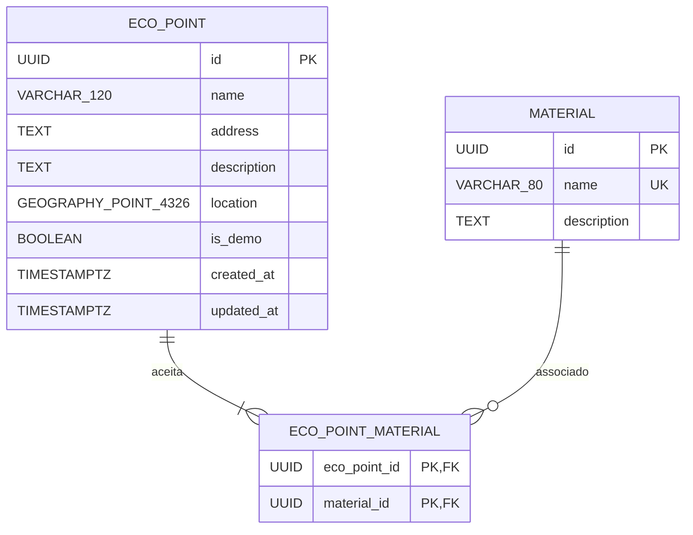

# Modelo de dados do EcoMapa

## 1. Escopo

A primeira versão do EcoMapa utiliza exatamente três tabelas próprias da aplicação no PostgreSQL com PostGIS:

- `eco_point`
- `material`
- `eco_point_material`

Essas tabelas representam os pontos de coleta, os materiais disponíveis e o relacionamento entre eles.

A extensão PostGIS possui seus próprios objetos internos no banco de dados, que não fazem parte do modelo de domínio da aplicação.

Não fazem parte da modelagem inicial tabelas de usuários, horários de funcionamento, avaliações ou comentários.

A modelagem prioriza simplicidade, integridade dos dados e suporte às consultas espaciais exigidas pelo projeto.

---

## 2. Modelo conceitual e relacionamentos

O EcoMapa possui duas entidades principais:

- **EcoPoint:** representa um ponto físico de coleta seletiva.
- **Material:** representa um tipo de material que pode ser recebido por um ponto.

Um ponto de coleta pode aceitar vários materiais, e um mesmo material pode ser aceito por vários pontos.

Portanto, existe um relacionamento muitos-para-muitos (N:N) entre as entidades.

Para representar esse relacionamento no banco de dados, utilizamos a tabela intermediária `eco_point_material`.

### Diagrama Entidade-Relacionamento



A tabela associativa permite que cada ponto possua vários materiais associados e que cada material esteja relacionado a diferentes pontos.

A regra de que todo ponto deve possuir pelo menos um material associado será garantida pelo backend durante as operações de cadastro e edição, utilizando transações.

---

## 3. Tabelas e campos

### 3.1. `eco_point`

Armazena os pontos de coleta seletiva e suas respectivas localizações geográficas.

| Campo | Tipo | Obrigatório? | Regra |
|---|---|---|---|
| `id` | `UUID` | Sim | Chave primária, gerada automaticamente |
| `name` | `VARCHAR(120)` | Sim | Não pode ser vazio ou composto apenas por espaços |
| `address` | `TEXT` | Sim | Endereço completo em um único campo; não pode ser vazio |
| `description` | `TEXT` | Não | Informações adicionais sobre o ponto |
| `location` | `GEOGRAPHY(Point, 4326)` | Sim | Localização geográfica obrigatória |
| `is_demo` | `BOOLEAN` | Sim | `NOT NULL`, `DEFAULT FALSE`; identifica registros fictícios |
| `created_at` | `TIMESTAMPTZ` | Sim | Data e hora de criação |
| `updated_at` | `TIMESTAMPTZ` | Sim | Data e hora da última atualização |

#### Identificador

O campo `id` utiliza UUID como chave primária.

O valor será gerado automaticamente pelo PostgreSQL utilizando:

```sql
DEFAULT gen_random_uuid()
```

Isso evita a necessidade de gerar identificadores manualmente durante as operações de cadastro.

#### Nome

O campo `name` armazena o nome do ponto de coleta.

Exemplos:

- Ponto de Coleta Central.
- Ecoponto Municipal.
- Cooperativa de Reciclagem.

O nome não possuirá restrição `UNIQUE`, pois podem existir pontos diferentes com nomes iguais.

Será utilizada uma restrição `CHECK` com `btrim()` para impedir valores vazios ou compostos apenas por espaços em branco.

#### Endereço

O campo `address` armazena o endereço completo em um único campo de texto.

Exemplo:

`Rua Exemplo, 120, Centro, Cajazeiras - PB`

O endereço poderá ser obtido por geocodificação reversa a partir da localização selecionada no mapa, mas deverá permanecer editável pela pessoa usuária.

O campo será obrigatório e terá uma restrição para impedir valores vazios ou compostos apenas por espaços em branco.

#### Descrição

O campo `description` armazena informações adicionais sobre o ponto de coleta.

Exemplos:

- Entrada pela lateral do estabelecimento.
- Localizado próximo à praça central.
- Recebe somente materiais previamente separados.

A descrição será opcional.

#### Localização geográfica

O campo `location` armazena a localização espacial do ponto utilizando:

`GEOGRAPHY(Point, 4326)`

O tipo `GEOGRAPHY` permite realizar cálculos de distância considerando coordenadas geográficas e utilizando metros nas operações de medição.

O tipo `Point` representa uma localização pontual, adequada para identificar a posição de cada ponto de coleta.

O SRID 4326 corresponde ao sistema de referência geográfica WGS 84, utilizado amplamente por sistemas de GPS e serviços de mapas.

As coordenadas deverão respeitar a seguinte ordem:

1. Longitude.
2. Latitude.

Essa ordem deverá ser observada na conversão das coordenadas recebidas do Leaflet para os valores utilizados pelo PostGIS.

A localização será obrigatória.

#### Identificação de registros fictícios

O campo `is_demo` indica se o ponto foi criado apenas para demonstração.

- `TRUE`: registro fictício.
- `FALSE`: registro não marcado como fictício.

O valor padrão será `FALSE`.

O campo permitirá identificar visualmente os registros de demonstração na interface, evitando que sejam confundidos com pontos reais.

O valor `FALSE` não representa uma confirmação oficial da existência ou funcionamento do ponto.

#### Datas de criação e atualização

Os campos `created_at` e `updated_at` utilizarão o tipo `TIMESTAMPTZ`.

Ambos terão como valor inicial:

```sql
DEFAULT CURRENT_TIMESTAMP
```

O campo `created_at` registra quando o ponto foi criado e não deverá ser alterado em atualizações posteriores.

O campo `updated_at` registra quando ocorreu a última atualização.

Para garantir que esse valor seja atualizado automaticamente, será criado um trigger no PostgreSQL que executará antes de cada operação `UPDATE` sobre `eco_point`.

---

### 3.2. `material`

Armazena os tipos de materiais que podem ser associados aos pontos de coleta.

| Campo | Tipo | Obrigatório? | Regra |
|---|---|---|---|
| `id` | `UUID` | Sim | Chave primária, gerada automaticamente |
| `name` | `VARCHAR(80)` | Sim | Obrigatório e `UNIQUE` |
| `description` | `TEXT` | Não | Descrição do material |

#### Identificador

O campo `id` utilizará UUID como chave primária, com geração automática pelo PostgreSQL:

```sql
DEFAULT gen_random_uuid()
```

#### Nome

O campo `name` armazena o nome do material.

O campo terá uma restrição `UNIQUE` para impedir o cadastro de categorias duplicadas.

Também será utilizada uma restrição `CHECK` para impedir nomes vazios ou compostos apenas por espaços em branco.

#### Descrição

O campo `description` permite registrar informações complementares sobre o material.

Será opcional.

#### Materiais iniciais

O catálogo inicial será composto pelos seguintes materiais:

| Material | Descrição |
|---|---|
| Papel e papelão | Papéis, caixas de papelão e embalagens de papel |
| Plástico | Garrafas PET, embalagens e outros materiais plásticos |
| Vidro | Garrafas, potes e recipientes de vidro |
| Metal | Latas, embalagens metálicas e outros materiais metálicos |
| Resíduos eletrônicos | Equipamentos eletrônicos, componentes e acessórios |
| Pilhas e baterias | Pilhas e baterias que necessitam de destinação adequada |
| Lâmpadas | Lâmpadas que necessitam de coleta e destinação específica |
| Óleo de cozinha usado | Óleo vegetal utilizado em atividades domésticas |

Esses materiais serão inseridos inicialmente por meio de um script de seed.

O catálogo será fixo na primeira versão. Não serão implementadas operações de cadastro, edição e exclusão de materiais pela interface.

---

### 3.3. `eco_point_material`

A tabela `eco_point_material` representa o relacionamento muitos-para-muitos entre pontos de coleta e materiais.

| Campo | Tipo | Obrigatório? | Regra |
|---|---|---|---|
| `eco_point_id` | `UUID` | Sim | Chave primária composta e chave estrangeira |
| `material_id` | `UUID` | Sim | Chave primária composta e chave estrangeira |

#### Chave primária composta

A chave primária será formada pela combinação:

```sql
PRIMARY KEY (eco_point_id, material_id)
```

Essa combinação impede que o mesmo material seja associado mais de uma vez ao mesmo ponto.

#### Chaves estrangeiras

O campo `eco_point_id` referencia:

`eco_point.id`

O relacionamento utilizará:

```sql
ON DELETE CASCADE
```

Quando um ponto de coleta for excluído, seus relacionamentos na tabela associativa também serão removidos automaticamente.

O campo `material_id` referencia:

`material.id`

O relacionamento utilizará:

```sql
ON DELETE RESTRICT
```

Um material não poderá ser excluído enquanto estiver associado a algum ponto de coleta.

---

## 4. Relacionamentos e regras de integridade

### Relacionamento entre pontos e materiais

A relação entre `eco_point` e `material` é muitos-para-muitos.

Um ponto pode aceitar diversos materiais, enquanto um mesmo material pode estar presente em diversos pontos.

A tabela `eco_point_material` representa esse relacionamento.

### Regras de integridade

| Código | Regra | Implementação |
|---|---|---|
| RN01 | Todo ponto deve possuir um nome | `NOT NULL` e `CHECK` |
| RN02 | Todo ponto deve possuir um endereço | `NOT NULL` e `CHECK` |
| RN03 | Todo ponto deve possuir localização geográfica | `NOT NULL` e tipo espacial |
| RN04 | Todo ponto deve aceitar pelo menos um material | Validação no backend com transação |
| RN05 | Um ponto pode aceitar vários materiais | Tabela associativa |
| RN06 | Um material pode estar associado a vários pontos | Tabela associativa |
| RN07 | Um mesmo material não pode ser associado duas vezes ao mesmo ponto | Chave primária composta |
| RN08 | Um ponto fictício deve ser identificado visualmente | Campo `is_demo` |
| RN09 | A criação e atualização dos pontos devem ser registradas | `created_at`, `updated_at` e trigger |
| RN10 | A localização deve representar um ponto geográfico | `GEOGRAPHY(Point, 4326)` |
| RN11 | Não deve ser possível excluir um material ainda associado a pontos | `ON DELETE RESTRICT` |
| RN12 | Ao excluir um ponto, suas associações devem ser removidas | `ON DELETE CASCADE` |

### Regra de pelo menos um material

A regra RN04 será garantida no backend.

Durante o cadastro, o backend deverá:

1. Validar se pelo menos um material foi selecionado.
2. Verificar se os materiais informados existem.
3. Iniciar uma transação.
4. Inserir o ponto na tabela `eco_point`.
5. Inserir os relacionamentos na tabela `eco_point_material`.
6. Confirmar a transação.

Se alguma operação falhar, a transação será revertida.

O mesmo cuidado deverá ser adotado durante a edição de um ponto, garantindo que seus dados e relacionamentos sejam atualizados como uma única operação lógica.

---

## 5. Índices

Serão utilizados índices para apoiar as consultas mais frequentes.

### Índice espacial

Será criado um índice GiST sobre `eco_point.location`.

Esse índice permitirá melhorar o desempenho de consultas espaciais, especialmente as buscas por proximidade e pela área visível do mapa.

### Índice na tabela associativa

A chave primária composta de `eco_point_material` cria um índice que começa por `eco_point_id`.

Também será criado um índice adicional sobre `material_id`:

```sql
CREATE INDEX idx_eco_point_material_material_id
ON public.eco_point_material (material_id);
```

Esse índice ajudará em consultas que precisam localizar pontos associados a determinado material.

### Índice UNIQUE

A restrição `UNIQUE` sobre `material.name` também cria um índice para impedir nomes duplicados e apoiar consultas pelo nome.

---

## 6. Consultas espaciais previstas

O atributo `location` será utilizado pelas operações espaciais do EcoMapa.

### Busca por proximidade

A aplicação permitirá buscar pontos localizados em um raio de 2 km a partir de uma coordenada de referência.

Será utilizada a função:

```sql
ST_DWithin()
```

Como a localização será armazenada com o tipo `GEOGRAPHY`, a distância poderá ser informada em metros.

O raio definido para a funcionalidade será de 2.000 metros.

A consulta receberá latitude e longitude como parâmetros, respeitando a ordem longitude e latitude na construção do ponto geográfico.

### Consulta pela área visível do mapa

A aplicação também consultará somente os pontos contidos nos limites geográficos da área atualmente visível no Leaflet.

O frontend enviará os seguintes valores:

- `west`: longitude oeste.
- `south`: latitude sul.
- `east`: longitude leste.
- `north`: latitude norte.

O backend utilizará esses limites para construir a região de consulta e recuperar somente os pontos pertencentes a ela.

Dessa forma, a aplicação evita carregar todos os pontos cadastrados a cada movimentação do mapa.

---

## 7. Estrutura e organização do banco

Os scripts SQL serão organizados no diretório `database/`.

```text
database/
│
├── migrations/
│   └── 001_create_initial_schema.sql
│
└── seeds/
    └── 001_insert_materials.sql
```

O diretório `migrations` conterá scripts responsáveis pela criação e evolução da estrutura do banco.

O diretório `seeds` conterá scripts responsáveis pela inserção de dados iniciais, como o catálogo de materiais.

A extensão PostGIS deverá ser habilitada antes da criação das tabelas que utilizam seus tipos e funções espaciais.

No ambiente Supabase, a extensão será instalada no schema `extensions`, enquanto as tabelas próprias da aplicação permanecerão no schema `public`.

---

## 8. Referências técnicas

- [PostgreSQL — UUID Type](https://www.postgresql.org/docs/current/datatype-uuid.html)
- [PostgreSQL — Date/Time Types](https://www.postgresql.org/docs/current/datatype-datetime.html)
- [PostGIS — Geography Type](https://postgis.net/docs/using_postgis_dbmanagement.html)
- [PostGIS — ST_DWithin](https://postgis.net/docs/ST_DWithin.html)
- [PostGIS — Spatial Indexing](https://postgis.net/docs/using_postgis_dbmanagement.html)
- [Supabase — PostGIS](https://supabase.com/docs/guides/database/extensions/postgis)